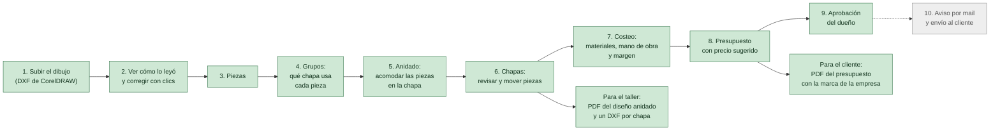
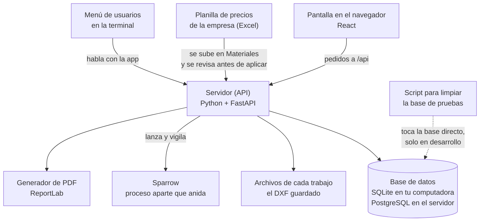
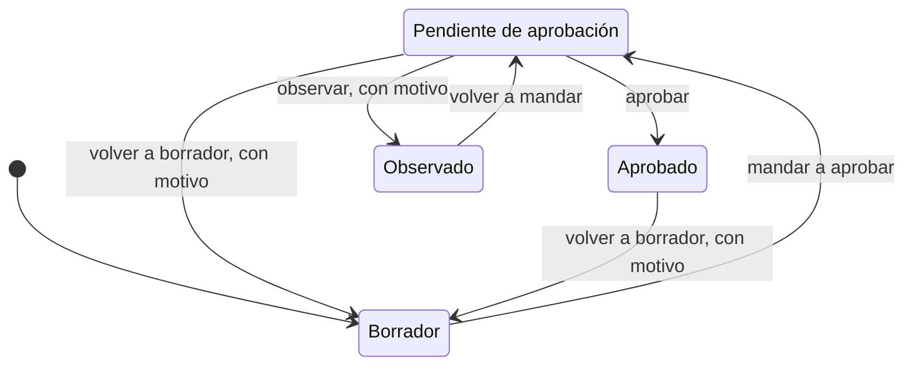
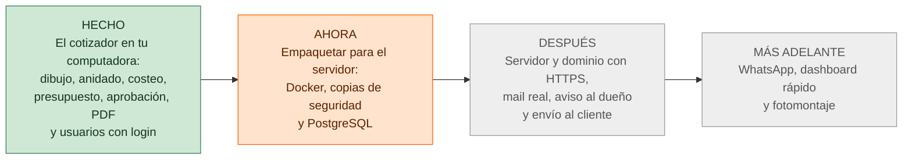

# Sistema de Cotización, Nesting y Aprobación para Cartelería

Un sistema a medida para una empresa de cartelería de gran formato en chapa. Hace tres cosas que hoy se hacen a mano y llevan mucho tiempo:

1. **Presupuestar:** calcula el costo de un cartel y sugiere el precio con el margen de la empresa.
2. **Acomodar las piezas en la chapa** (el *anidado*, o *nesting*), para desperdiciar lo menos posible.
3. **Hacer aprobar el presupuesto** al dueño antes de que llegue al cliente.

Más adelante: mandarle el presupuesto al cliente con el fotomontaje del cartel sobre el frente de su local.

> **Hoy:** el cotizador funciona de punta a punta **en tu computadora**: se carga el dibujo, se acomodan las piezas, se calcula el presupuesto, se aprueba y se baja el PDF. Hay usuarios con contraseña. **Todavía no está en un servidor** y no manda mails.

**Qué sigue:** [`docs/plan/PLAN-MAESTRO.md`](docs/plan/PLAN-MAESTRO.md) · **Equipo:** Enzo (todo lo que no es el motor) y Vale (motor de anidado) · **Última actualización:** 2026-11-11 · **Versión etiquetada:** `v2026.11.09` (una foto del estado de ese día; todavía no hay numeración) · [Bitácora](docs/BITACORA.md)

---

## Por dónde empiezo

| Quiero... | Voy a |
|---|---|
| Entender qué hace el sistema | [Qué hace el sistema](#qué-hace-el-sistema) |
| Saber cómo está armado por dentro | [Cómo está armado](#cómo-está-armado) |
| Saber en qué estamos y qué falta | [En qué estamos](#en-qué-estamos) |
| Probarlo en mi computadora | [Probar el sistema](#probar-el-sistema-en-tu-computadora) y la [guía completa](docs/GUIA-PROBAR-EL-SISTEMA.md) |
| Aprender a usar el sistema, paso a paso | [`GUIA-DEL-USUARIO.html`](docs/guias/GUIA-DEL-USUARIO.html) |
| Sumarme al desarrollo (arquitectura, convenciones, recetas) | [`GUIA-DEL-DESARROLLO.html`](docs/guias/GUIA-DEL-DESARROLLO.html) |
| Administrar usuarios o limpiar la base de pruebas | [`MANUAL-USUARIOS.md`](docs/MANUAL-USUARIOS.md) |
| Ver el orden de lo que se va a construir | [`PLAN-MAESTRO.md`](docs/plan/PLAN-MAESTRO.md) |
| Saber qué pasó en los últimos días | [`BITACORA.md`](docs/BITACORA.md) |
| Escribir código | [`CONVENCIONES.md`](docs/CONVENCIONES.md) y la [guía de lectura](#guía-de-lectura) |
| Buscar un documento | [Índice de documentos](#índice-de-documentos) |

**En este README:** [Qué hace el sistema](#qué-hace-el-sistema) · [Cómo está armado](#cómo-está-armado) · [El presupuesto y sus estados](#el-presupuesto-y-sus-estados) · [En qué estamos](#en-qué-estamos) · [Lo que A17 cambió en el motor](#lo-que-a17-cambió-en-el-motor-2026-10-29) · [Probar el sistema](#probar-el-sistema-en-tu-computadora) · [Dónde está cada cosa](#dónde-está-cada-cosa) · [Hoja de ruta](#hoja-de-ruta) · [Guía de lectura](#guía-de-lectura) · [Índice de documentos](#índice-de-documentos) · [Reglas](#las-tres-reglas-que-no-se-negocian) · [Equipo](#equipo-y-división-del-trabajo) · [Tecnología](#tecnología) · [Glosario](#glosario) · [Contribuir](#contribuir)

---

## Qué hace el sistema

El recorrido de un cartel, desde el dibujo hasta el cliente. En verde, lo que ya funciona; en gris, lo que falta.



En palabras simples:

- **1 y 2.** El diseñador exporta el dibujo desde CorelDRAW como **DXF**. El sistema lo lee y muestra una imagen de cómo lo entendió; si se equivocó, se corrige con clics. Esas correcciones se recuerdan si el mismo archivo vuelve a llegar.
- **3 y 4.** Cada forma del dibujo es una **pieza**. Las piezas se reparten en **grupos**, uno por material (por ejemplo, chapa negra y acrílico).
- **5 y 6.** El **anidado** acomoda las piezas sobre las chapas. Lo hace **Sparrow**: usa los huecos de las piezas grandes para meter las chicas, gira las piezas y parte (*secciona*) las que no entran enteras en una chapa. Después se revisa, y se puede pasar una pieza de una chapa a otra.
- **7 y 8.** El **costeo** suma el material usado, los artículos del catálogo (vinilos, pintura, tornillos...), la mano de obra, el IVA y el margen. El sistema **sugiere el precio** y marca en amarillo lo que queda por debajo.
- **9.** El dueño aprueba, observa o devuelve el presupuesto. Ver [sus estados](#el-presupuesto-y-sus-estados).
- **10.** Falta: que el dueño reciba un aviso por mail con un link, y que el presupuesto aprobado salga al cliente.

### Quién puede hacer qué

Cada persona entra con **usuario y contraseña**. Hay dos permisos, que se combinan:

| Persona | Permisos | Qué puede hacer |
|---|---|---|
| **Diseñador** | ninguno | Armar trabajos y presupuestos, y mandarlos a aprobar |
| **Quien aprueba** | «puede aprobar» | Aprobar o devolver presupuestos |
| **Quien administra** | «administra usuarios» | Crear usuarios, cambiar permisos, dar de baja y restablecer contraseñas |

El dueño suele tener los dos. Todos ven todos los trabajos. Cómo se administra: [`docs/MANUAL-USUARIOS.md`](docs/MANUAL-USUARIOS.md).

---

## Cómo está armado



- **La pantalla** no calcula nada: pide todo al servidor, que es el que sabe.
- **El servidor** guarda los trabajos en la **base de datos** y el dibujo original en archivos. Al arrancar, si la base está atrasada respecto del código, **se actualiza sola** y antes deja un respaldo en `backend/local/respaldo-<fecha>-.../`.
- **Sparrow** corre en un proceso aparte porque tarda: el servidor sigue respondiendo y la pantalla muestra una barra de avance (con tiempo máximo y botón de cancelar). Se pueden hacer varios anidados a la vez.
- **La planilla de precios** de la empresa es la fuente de los materiales y sus precios. No se cargan a mano: se sube, se miran los cambios y se aplican.
- **Los menús de la terminal** están en `backend/scripts/`. Se explican en el [manual](docs/MANUAL-USUARIOS.md).

---

## El presupuesto y sus estados

Un presupuesto pasa por cuatro estados. Lo que está **pendiente** o **aprobado** no se edita; para tocarlo hay que volverlo a borrador, y el sistema pide un motivo y lo deja en el historial.



- **Observado** quiere decir que el dueño lo miró y pidió un cambio. Vuelve a quien lo armó, que lo edita ahí mismo.
- Cada cambio de estado queda en el **historial**: quién lo hizo, cuándo y por qué.
- Aprobar necesita el permiso «puede aprobar». El nombre de quien aprueba sale de su sesión: ya no se escribe a mano.

---

## En qué estamos

*Actualizado el 2026-11-11. El detalle vive en el [`PLAN-MAESTRO.md §7`](docs/plan/PLAN-MAESTRO.md) y el mapa en [`MAPA-DEL-PROYECTO.md`](docs/MAPA-DEL-PROYECTO.md).*

### Qué hay hoy

| Área | Qué funciona |
|---|---|
| **Leer el dibujo** | Se ve una imagen de cómo se leyó el DXF antes de cargarlo, se corrige con clics, y las piezas que no entran en una chapa se seccionan solas. Las correcciones se recuerdan por el contenido del archivo. |
| **Anidado y chapas** | Sparrow como motor principal. Varios anidados a la vez, piezas chicas en los huecos de las grandes, giro libre, el material usado en ancho × alto, todas las chapas juntas con piezas movibles entre ellas. El sobrante de una chapa se guarda como **retazo**, que dice de dónde salió y si está disponible, en uso o usado. |
| **Salida para el taller** | Un PDF del diseño anidado (la hoja del diseño completo más las chapas) y un DXF por chapa para la máquina. |
| **Materiales y precios** | Pantalla de Materiales alimentada por la planilla de la empresa: 44 materiales, 59 medidas y 288 artículos cargados. |
| **Presupuesto** | Costeo con precio sugerido, artículos del catálogo, lista de todos los presupuestos y PDF para el cliente con la marca de la empresa (logo, negro y naranja, datos de contacto). Sin costos ni márgenes a la vista. |
| **Aprobación** | Cuatro estados con historial y bloqueo de edición. |
| **Usuarios** | Login, dos permisos, «Mi cuenta» para cambiar la contraseña, bloqueo de 15 minutos tras 5 intentos fallidos, pantalla de Usuarios y un menú en la terminal. |
| **Inicio** | Una barra fija arriba y una página con las tarjetas de los trabajos, cada una con la miniatura pintada por chapa y en qué paso quedó. |

Una sola regla del servidor decide qué anidado cuenta para el presupuesto: el costeo, la tarjeta del inicio, el PDF y Chapas dicen lo mismo. Si se cambia la chapa de un grupo ya anidado, ninguno lo da por terminado ni lo cobra.

### Lo que falta y quién lo mueve

| Qué | Para qué | Quién |
|---|---|---|
| **Entrega A3 del servidor:** Docker, copias de seguridad diarias y llevar el catálogo a PostgreSQL | Que todo levante con un comando, igual que en el servidor | **Vale** (acordado el 2026-11-11). Se verifica en el CI de GitHub, porque no hay Docker en la máquina de Enzo ([plan](docs/plan/1.1-servidor-y-login/plan.md)) |
| **El servidor real:** alquilarlo, el dominio y HTTPS | Entrar desde el celular | Enzo, etapa 4 |
| **Mail real y aviso al dueño; envío al cliente** con el presupuesto congelado | Cerrar la aprobación | Después del servidor |
| **WhatsApp** | Avisos por ese canal | Etapa 4 |
| **Medir la segunda tanda de A17** (unos 75 minutos con la máquina libre) | Decidir cómo repartir el tiempo del anidado | Enzo, solo cuando la pida |

**En espera por decisión de Enzo (2026-10-22):** colores de referencia por pieza y leer archivos `.cdr`.

**Más adelante, sin fecha:** cobrar por lo que realmente se usa de cada chapa, proponer un retazo al anidar un trabajo nuevo, mano de obra por etapa, el dashboard rápido y el fotomontaje.

**Decidido no hacer (2026-11-09):** importar varios diseños a la vez en pantalla (el propósito es **un diseño por trabajo**; los grupos de chapas cubren los materiales distintos) y cambiar cómo decide el lector qué es pieza y qué es agujero (se midió y el valor hoy es bajo).

**Descartado como pedido (2026-11-11):** lo que no se puede saber desde desarrollo y ensuciaba la lista: las dos medidas de catálogo sin precio, el código repetido de la planilla, la hoja impresa para medir, las dudas del dueño, el aro soldado del diseñador y la veta (las chapas son uniformes).

**Anotado para decidir cuando haga falta (revisión de la aprobación):** editar un cliente cambia el PDF de un presupuesto ya aprobado; dos personas aprobando u observando a la vez el mismo presupuesto; y las piezas y el anidado siguen editables con el presupuesto aprobado. Ver [`A20`](docs/historico/A20-aprobacion-del-presupuesto/diseno.md).

**Lo ya hecho, entrega por entrega,** con fechas y migraciones aplicadas: [`docs/historico/ENTREGAS-HECHAS.md`](docs/historico/ENTREGAS-HECHAS.md).

---

## Lo que A17 cambió en el motor (2026-10-29)

El sprint para cerrar lo chico que quedó suelto (A17) terminó el 2026-10-29: [`docs/historico/A17-pulir-lo-suelto/`](docs/historico/A17-pulir-lo-suelto/diseno.md). Cómo quedó cada tanda está en §8 de su diseño. Lo que tocó en el motor, todo en `main`:
- **`sparrow_worker.py`:**
  - la etapa de vaciar chapas mide cuánto tarda de verdad cada consulta y no empieza una que no termina a tiempo (tanda 1);
  - el tiempo repartido en varias vueltas cortas (`repartir_tiempo`), uno de los dos caminos para que Complejo dé 7 chapas más seguido. Está **apagado** hasta medirlo (tanda 2).
- **`sparrow.py`:**
  - la carpeta temporal va al lado de los datos;
  - «entra en la chapa» usa los mismos giros que el anidado: con giro libre, cualquier ángulo;
  - el registro dice de qué anidado es lo que escribió Sparrow (las tres, tanda 1);
  - el otro camino, dos búsquedas a la vez dentro del mismo anidado (`busquedas_a_la_vez`), también **apagado** (tanda 2).
- **`huecos_primero.py`** (tanda 2): `meter_en_huecos` puede probar otros órdenes de piezas en cada hueco. Por defecto, el de siempre.
- **`services/nesting/reacomodar.py`**, nuevo (tanda 3): al pasar una pieza a otra chapa en la pestaña Chapas, si no entra en lo libre, esa chapa se reacomoda con Sparrow, con «Deshacer».
- **`services/seccionado/grilla.py`:** la segunda pasada prueba los ángulos del medio, en vez de repetir los ya probados (tanda 1), y cada tramo lleva un color distinto del de sus vecinos (tanda 4).

---

## Probar el sistema en tu computadora

Todo corre en local, sin instalar bases de datos ni Docker, y **no necesita ningún archivo del cliente**: trae datos de demostración. Necesitás **Git**, **Python 3.11 o más nuevo** y **Node.js 18 o más nuevo**. Vas a tener tres terminales abiertas a la vez.

```
git clone https://github.com/enzopazzelli/carteleria.git
cd carteleria
```

**Terminal 1: el servidor** (queda corriendo)

```
cd backend
python -m venv .venv
.venv\Scripts\python -m pip install -r scripts/requirements-scripts.txt
.venv\Scripts\python -m uvicorn app.api.app:app --reload
```

**Una sola vez, el primer usuario** (sin él la pantalla no deja entrar), con el servidor ya arrancado:

```
.venv\Scripts\python -m app.usuarios crear enzo --nombre "Enzo" --administrador --puede-aprobar --generar
```

Imprime una contraseña temporal; al entrar, la pantalla te pide elegir una propia (al menos 10 caracteres).

**Terminal 2: datos de demostración** (con el servidor corriendo)

```
cd backend
.venv\Scripts\python scripts/cargar_catalogo_demo.py
.venv\Scripts\python scripts/generar_dxf_demo.py
```

**Terminal 3: la pantalla** (queda corriendo)

```
cd frontend
npm ci
npm run dev
```

Abrí **exactamente** `http://localhost:5173` (no `127.0.0.1`, no otro puerto). En Mac o Linux, cambiá `.venv\Scripts\python` por `.venv/bin/python`.

**El recorrido paso a paso** (qué hacer en cada pantalla y qué tendrías que ver), cómo probar con tus propios DXF y qué tener en cuenta: [`docs/GUIA-PROBAR-EL-SISTEMA.md`](docs/GUIA-PROBAR-EL-SISTEMA.md). Para probar con datos reales sin tocar la base real: [`docs/GUIA-PRUEBAS-LOCALES.md §6`](docs/GUIA-PRUEBAS-LOCALES.md).

**Las pruebas automáticas del servidor:** `cd backend` y `pytest`. La documentación interactiva de la API queda en `http://localhost:8000/docs`.

---

## Dónde está cada cosa

```
cartelería/
├── README.md              ← estás acá
│
├── docs/                  ← la documentación, ordenada por estado (CONVENCIONES.md §8 bis)
│   ├── (raíz)             Referencia que vale siempre: mapa, registro, épica, backlog,
│   │                      bitácora, convenciones, manual de usuarios, guías de prueba
│   ├── plan/              Lo que sigue: el plan maestro y un diseño por sub-proyecto
│   ├── motor/             El motor de anidado: contrato, mediciones, plan del carril
│   ├── cliente/           Lo que dijo y entregó la empresa
│   └── historico/         Lo ya ejecutado o reemplazado: no se sigue, se consulta
│
├── fuentes/               ← documentos originales (no se editan)
│
├── backend/               ← el servidor, en Python
│   ├── app/api/           Las rutas: lo que la pantalla le pide al servidor
│   ├── app/services/      La lógica, por tema: ingesta (leer el DXF), nesting,
│   │                      seccionado, piezas, catalogo, presupuesto, usuarios
│   ├── app/modelos/       Las tablas de la base de datos
│   ├── app/cola/          Los anidados que corren en segundo plano
│   ├── alembic/           Migraciones: los cambios de la base, versionados
│   ├── scripts/           Herramientas: menú de usuarios, limpiar la base, copiar la
│   │                      base para probar, datos de demostración, extractores del Excel
│   ├── tests/             Las pruebas automáticas, espejo de app/
│   └── local/             Tu base, los DXF guardados, los respaldos y el logo de la
│                          empresa. NO va a git: tiene datos del cliente
│
├── frontend/              ← la pantalla (React + Vite + TypeScript + Tailwind)
│   └── src/routes/        Inicio, Trabajos, Presupuestos, Materiales, Usuarios, Mi cuenta
│                          y el espacio de trabajo con sus cinco etapas
│
├── nesting-engine/        ← Deepnest, un motor estudiado y medido; hoy sin interfaz
└── prototipo-dashboard/   ← maqueta HTML del dashboard rápido (se abre en el navegador)
```

**Nunca se sube a git** (ver [`CONVENCIONES.md §4`](docs/CONVENCIONES.md)): archivos del cliente (`.cdr`, `.dxf`, el Excel), contraseñas, y todo lo que está en `backend/local/`. El repositorio es público.

---

## Hoja de ruta



El orden vigente es el del [`PLAN-MAESTRO.md`](docs/plan/PLAN-MAESTRO.md), en cinco etapas:

1. **Preparar:** documentación al día.
2. **Recorrido fino:** login, presupuesto sin anidado, PDF, aprobación del dueño y envío por mail, todo en Docker local igual que en el servidor.
3. **Engordar:** importar y revisar, catálogo y precios, cotizador completo, aprobación y envío completos.
4. **Resto del alcance:** dashboard y fotomontaje.
5. **Conectar lo externo:** servidor real, mail, WhatsApp y formato de la empresa. Hasta acá, nada de afuera frena el trabajo: se usan reemplazos locales.

El motor de anidado se conecta en paralelo, y hoy ya está en el producto (Sparrow). Los hitos y las semanas de la estimación original siguen en [`docs/EPICA.md §8`](docs/EPICA.md).

---

## Guía de lectura

### 🧭 Qué sigue

[`docs/plan/PLAN-MAESTRO.md`](docs/plan/PLAN-MAESTRO.md) — el plan vigente: en qué orden se construye todo lo que no es el motor y dónde se conecta el motor cuando esté listo. Si un documento dice otra cosa sobre el orden de trabajo, vale el plan maestro.

### 🆕 Es tu primera vez acá

Una hora, en este orden:

| # | Qué leer | Tiempo | Qué te llevás |
|---|---|---|---|
| 1 | [`docs/EPICA.md §1-2`](docs/EPICA.md) | 10 min | Qué problema resuelve y de dónde salió (con las citas del audio del cliente) |
| 2 | [`docs/EPICA.md §7-8`](docs/EPICA.md) | 10 min | Las 9 features y el roadmap con los 6 hitos |
| 3 | [`docs/EPICA.md §9`](docs/EPICA.md) | 15 min | Los 10 ADRs — las decisiones técnicas ya cerradas y por qué |
| 4 | [`docs/CONVENCIONES.md`](docs/CONVENCIONES.md) | 15 min | **Obligatorio antes de escribir código** |
| 5 | [`docs/REGISTRO.md §7`](docs/REGISTRO.md) | 5 min | El tablero: qué está abierto hoy |

### 🔄 Volvés después de un tiempo

[`docs/plan/PLAN-MAESTRO.md`](docs/plan/PLAN-MAESTRO.md) para saber qué sigue, y [`docs/BITACORA.md`](docs/BITACORA.md) — las últimas tres entradas — para saber qué pasó. Después [`docs/REGISTRO.md §7`](docs/REGISTRO.md) para ver qué se movió.

### 💻 Vas a tomar una historia

1. [`docs/BACKLOG.md`](docs/BACKLOG.md) — la historia, sus criterios de aceptación y sus dependencias
2. [`docs/REGISTRO.md §2`](docs/REGISTRO.md) — si la historia usa algún `PAR-xx`
3. [`docs/DECISIONES-Y-BLOQUEANTES.md`](docs/DECISIONES-Y-BLOQUEANTES.md) — si toca nesting, costeo, schema o fotomontaje: hay correcciones a la spec original que aplican
4. [`docs/CONVENCIONES.md §9`](docs/CONVENCIONES.md) — el checklist antes de abrir el PR

### 🗣️ Vas a reunirte con el cliente

- **Reunión de arranque** (para que confirme el inicio) → [`docs/cliente/PROPUESTA-CLIENTE.md`](docs/cliente/PROPUESTA-CLIENTE.md) — problema, solución, cronograma de 2 meses, insumos e inversión, sin jerga interna.
- **Los tres encuentros de relevamiento**, ya confirmado el inicio → [`docs/cliente/GUION-ENTREVISTAS-RELEVAMIENTO.md`](docs/cliente/GUION-ENTREVISTAS-RELEVAMIENTO.md) — las 19 preguntas desarrolladas para llevar a la reunión: en lenguaje llano, por qué importa cada una y qué insumos pedir. Versión condensada en [`docs/REGISTRO.md §6`](docs/REGISTRO.md).

### 📊 Querés presentarle el proyecto a alguien

[`docs/EPICA.md §1`](docs/EPICA.md) — el resumen ejecutivo está escrito para eso: una página, sin jerga, con los hitos y qué gana el cliente en cada uno.

---

## Índice de documentos

### `docs/` — referencia

Lo que vale siempre. Se edita.

| Documento | Qué contiene | Se actualiza |
|---|---|---|
| [`MAPA-DEL-PROYECTO.md`](docs/MAPA-DEL-PROYECTO.md) | **Dónde estamos parados**: estado de cada feature, dónde se corta el flujo del dato, qué bloquea qué | Cuando cambia el estado de una feature |
| [`REGISTRO.md`](docs/REGISTRO.md) | **Fuente de verdad** de supuestos (`SUP`), parámetros (`PAR`), insumos (`B`/`T`), preguntas (`P`) y decisiones pendientes (`D`), con guion de relevamiento y tablero de estado | Cada vez que se abre o se cierra un ID |
| [`EPICA.md`](docs/EPICA.md) | Contexto y origen, requisitos R1-R11, roles, alcance, features F0-F8, roadmap, ADRs, arquitectura, NFRs, riesgos, DoR/DoD, trazabilidad, glosario | Cuando cambia el alcance o una decisión |
| [`BACKLOG.md`](docs/BACKLOG.md) | Las historias, cada una con narrativa, criterios Gherkin, estimación, dependencias y sprint | Al partir o agregar historias |
| [`BITACORA.md`](docs/BITACORA.md) | Registro cronológico: qué se hizo, qué se decidió, qué cambió en el registro, qué queda pendiente | **Al cerrar cada jornada de trabajo** |
| [`CONVENCIONES.md`](docs/CONVENCIONES.md) | Regla de no-hardcode, división del trabajo, Git y commits, migraciones, código, **dónde va cada documento** (§8 bis) | Cuando acordamos una regla nueva |
| [`DECISIONES-Y-BLOQUEANTES.md`](docs/DECISIONES-Y-BLOQUEANTES.md) | Las correcciones a la especificación técnica original, con severidad e historia que las resuelve. Más `ADR-03` en detalle (fotomontaje) | Rara vez — es un documento de cierre |
| [`guias/GUIA-DEL-USUARIO.html`](docs/guias/GUIA-DEL-USUARIO.html) | **Guía completa para quien usa el sistema:** el recorrido de un cartel, cada pantalla, estados del presupuesto, problemas comunes y glosario. Con la marca; se abre en el navegador | Cuando cambia una pantalla o un permiso |
| [`guias/GUIA-DEL-DESARROLLO.html`](docs/guias/GUIA-DEL-DESARROLLO.html) | **Guía completa para desarrolladores:** arquitectura, puesta en marcha, dominio, pruebas y CI, Git, recetas y prácticas que sirven en otros proyectos | Cuando cambia la arquitectura o una convención |
| [`MANUAL-USUARIOS.md`](docs/MANUAL-USUARIOS.md) | **Manual para el dueño:** cómo entrar y cambiar la contraseña, cómo administrar usuarios (pantalla y menú de la terminal) y cómo limpiar la base de desarrollo | Cuando cambian los permisos o los menús |
| [`GUIA-PROBAR-EL-SISTEMA.md`](docs/GUIA-PROBAR-EL-SISTEMA.md) | El recorrido paso a paso por las pantallas, cómo probar con tus propios DXF y qué tener en cuenta | Cuando cambia una pantalla del recorrido |
| [`GUIA-PRUEBAS-LOCALES.md`](docs/GUIA-PRUEBAS-LOCALES.md) | Cómo probar con datos reales del cliente: el xlsx de AppSheet y los DXF de `modelos/`. Nunca se commitea lo que producen | Cuando cambian los datos reales disponibles |

### `docs/plan/` — lo que sigue

| Documento | Qué contiene |
|---|---|
| [`1.1-servidor-y-login/`](docs/plan/1.1-servidor-y-login/diseno.md) | Usuarios, Docker, PostgreSQL, copias de seguridad y el servidor alquilado. El login ya está; sigue la entrega A3 ([`plan.md`](docs/plan/1.1-servidor-y-login/plan.md)) |
| [`PLAN-MAESTRO.md`](docs/plan/PLAN-MAESTRO.md) | **El plan vigente.** Etapas, sub-proyectos en orden, el enchufe del motor y las decisiones abiertas. Cada sub-proyecto suma acá su propia carpeta con `diseno.md` y `plan.md` |

### `docs/motor/` — el motor de anidado

| Documento | Qué contiene |
|---|---|
| [`PLAN-RUMBO-ANIDADO-Y-REVISION.md`](docs/motor/PLAN-RUMBO-ANIDADO-Y-REVISION.md) | Rumbo del anidado para piezas grandes y curvas (carril A) y pantalla de revisión (carril B, que el plan maestro absorbe como 2.1) |
| [`PLAN-VALIDACION-CORTE-MANUAL.md`](docs/motor/PLAN-VALIDACION-CORTE-MANUAL.md) | Spike que mide el corte manual del diseñador contra los motores, con los resultados de A1 y A2 |
| [`COMO-FUNCIONA-CADA-MOTOR.md`](docs/motor/COMO-FUNCIONA-CADA-MOTOR.md) | Cómo funcionan `rectpack` y Deepnest, qué da cada uno y las mediciones sobre DXF reales |
| [`CONTRATO-NESTING-ENGINE.md`](docs/motor/CONTRATO-NESTING-ENGINE.md) | El JSON que hablan Python y el motor irregular (`nesting-engine/`) |

### `docs/cliente/` — lo que dijo y entregó la empresa

| Documento | Qué contiene |
|---|---|
| [`PROPUESTA-CLIENTE.md`](docs/cliente/PROPUESTA-CLIENTE.md) | Prospecto para la reunión de arranque: problema, solución, cronograma, insumos e inversión, sin jerga interna. La presentación está en [`presentaciones/`](docs/cliente/presentaciones/) |
| [`RELEVAMIENTO-REUNION-ARRANQUE.md`](docs/cliente/RELEVAMIENTO-REUNION-ARRANQUE.md) | Hallazgos depurados de la reunión de arranque con Aníbal (Megacarteles) |
| [`GUION-ENTREVISTAS-RELEVAMIENTO.md`](docs/cliente/GUION-ENTREVISTAS-RELEVAMIENTO.md) | Las preguntas de `REGISTRO.md §6` desarrolladas para los tres encuentros de relevamiento |
| [`RELEVAMIENTO-EXPORT-APPSHEET.md`](docs/cliente/RELEVAMIENTO-EXPORT-APPSHEET.md) | Las 19 hojas del export de AppSheet, qué hay en cada una y qué implica para el modelo |
| [`DASHBOARD-VISTAS.md`](docs/cliente/DASHBOARD-VISTAS.md) | Las 9 vistas del dashboard actual, de qué tabla sale cada una y cómo construirlas en F8 |
| [`PLANILLA-PARAMETROS-TALLER.md`](docs/cliente/PLANILLA-PARAMETROS-TALLER.md) | Planilla para llenar con el operario: kerf, márgenes y veta (`B-03`, `B-04`) |
| [`ANALISIS-MUESTRA-MEGACARTELES.md`](docs/cliente/ANALISIS-MUESTRA-MEGACARTELES.md) | Qué trae la primera muestra real de diseño (`Muestra Vectores.dxf`) y qué hace el sistema con ella |

### `docs/historico/` — ejecutado o reemplazado

**No se sigue.** Se consulta para entender por qué el código es como es; el código cita estos documentos en sus comentarios.

| Documento | Qué fue |
|---|---|
| [`PLAN-SLICE-VERTICAL.md`](docs/historico/PLAN-SLICE-VERTICAL.md) | Sacar el nesting del script local a una app real: API, persistencia y cola. Ejecutado |
| [`PLAN-SLICE-COTIZADOR.md`](docs/historico/PLAN-SLICE-COTIZADOR.md) | Presupuesto, líneas de costo con override y desglose por API. Ejecutado salvo el PDF |
| [`PLAN-GRUPOS-DE-CORTE.md`](docs/historico/PLAN-GRUPOS-DE-CORTE.md) | Catálogo con precio real y un trabajo repartido en varios materiales (`CART-211`). Ejecutado |
| [`PLAN-ANALISIS-DXF.md`](docs/historico/PLAN-ANALISIS-DXF.md) | Análisis de un DXF con varios diseños y hojas ya armadas (`CART-509` a `CART-511`). Ejecutado |
| [`frontend-cotizador/`](docs/historico/frontend-cotizador/) | Diseño y plan del frontend del cotizador. Ejecutado |
| [`PLAN-MOTOR-NESTING-DEEPNEST.md`](docs/historico/PLAN-MOTOR-NESTING-DEEPNEST.md) | Deepnest como motor único en un microservicio Node. Se ejecutó el spike; el rumbo siguió en `motor/` |
| [`PLAN-MOTOR-NESTING-PYTHON-NATIVO.md`](docs/historico/PLAN-MOTOR-NESTING-PYTHON-NATIVO.md) | Alternativa sin servicios externos, sobre `shapely` y `rectpack`. Se ejecutó el anidado en huecos |
| [`FACTIBILIDAD-NESTING-WEB.md`](docs/historico/FACTIBILIDAD-NESTING-WEB.md) | Investigación de SVGnest, Deepnest y SheetNest como motores en el navegador |
| [`ENTREGAS-HECHAS.md`](docs/historico/ENTREGAS-HECHAS.md) | Lo que ya está en `main`, entrega por entrega (A10 a A25), con fechas y migraciones aplicadas en la base real |
| [`SPIKE-CDR.md`](docs/historico/SPIKE-CDR.md) | ¿Se puede leer `.cdr` sin CorelDRAW? Sí, con dos límites conocidos. Lo cita `D-11` |

### `fuentes/` — documentos originales

No se editan. Quedan como contexto histórico y como respaldo de de dónde salió cada decisión.

| Documento | Autor | Qué aportó | Vigencia |
|---|---|---|---|
| [`propuesta-carteleria-automatizacion.md`](fuentes/propuesta-carteleria-automatizacion.md) | Enzo | Análisis del problema, traducción del audio a los requisitos R1-R11, distinción nesting rectangular vs. irregular, riesgos, métricas de éxito | ✅ Base conceptual |
| [`Especificación Técnica de Desarrollo…md`](fuentes/Especificación%20Técnica%20de%20Desarrollo_%20Sistema%20de%20Nesting,%20Cotización%20e%20IA%20para%20Cartelería.md) | Enzo | Stack tecnológico, schema SQL, código del motor de nesting, integración de IA, docker-compose, hitos | ⚠️ Vigente **con las 13 correcciones** de [`DECISIONES-Y-BLOQUEANTES.md`](docs/DECISIONES-Y-BLOQUEANTES.md) |
| [`Proyecto_Final_Automatizacion_Carteleria.md`](fuentes/Proyecto_Final_Automatizacion_Carteleria.md) | Vale | Síntesis de los dos anteriores, alcance por módulos, cronograma de 7 fases, checklist de insumos, 14 preguntas al cliente | ✅ Base del roadmap |

---

## Las tres reglas que no se negocian

Desarrolladas en [`docs/CONVENCIONES.md`](docs/CONVENCIONES.md). Si te llevás solo tres cosas de este README:

**1. No hardcode.** Ningún valor configurable va escrito en la lógica ni repetido en dos documentos. Todo default tiene un `PAR-xx` en [`docs/REGISTRO.md`](docs/REGISTRO.md) y el resto lo referencia por ID. Lo mismo con supuestos (`SUP-xx`) y dudas (`P-xx`). Si al cambiar un valor hay que tocar más de un lugar, es que estaba hardcodeado en algún lado.

**2. Todo en milímetros.** Toda medida geométrica en mm, toda área en mm², y la unidad va en el nombre de la variable (`ancho_mm`, `area_mm2`). La conversión a m² es solo de presentación. Un SVG en px interpretado como mm produce un presupuesto catastróficamente equivocado que nadie detecta hasta que llega la chapa cortada.

**3. Se documenta a medida que se avanza.** Entrada en [`docs/BITACORA.md`](docs/BITACORA.md) al cerrar cada jornada, y [`docs/REGISTRO.md`](docs/REGISTRO.md) actualizado al abrir y cerrar cada sprint. Un registro desactualizado es peor que no tenerlo, porque genera confianza falsa.

---

## Equipo y división del trabajo

| Carril | Dueño | Alcance |
|---|---|---|
| **Producto** | Enzo | Todo lo que no es el motor de anidado, en el orden del plan maestro |
| **Motor** | Vale | El motor de anidado y sus mejoras |
| **Despliegue** | Vale | Dockerizar el proyecto y desplegarlo (entrega A3 y servidor), desde el 2026-11-11 |

Detalle, zona compartida y propiedad del código en [`docs/CONVENCIONES.md §2-3`](docs/CONVENCIONES.md). **Capacidad asumida:** part-time, unas 15 a 20 horas por semana cada uno (`SUP-15`).

---

## Tecnología

| Capa | Qué se usa |
|---|---|
| Servidor | Python 3.11 o más nuevo, con FastAPI |
| Base de datos | SQLAlchemy y Alembic. SQLite en tu computadora, PostgreSQL en el servidor |
| Usuarios | Contraseñas con `argon2`; sesión por cookie |
| Anidado | **Sparrow** (`spyrrow`), el motor principal. `rectpack` queda como motor de prueba. Deepnest se estudió y no está conectado |
| Geometría y DXF | `shapely` y `ezdxf` |
| PDF | ReportLab |
| Excel | `openpyxl`, para la planilla de precios |
| Pantalla | React 18, Vite, TypeScript, Tailwind y React Query |
| Tareas largas | Hilos y un proceso aparte para Sparrow |
| Servidor real (planeado) | Docker Compose, Caddy para el HTTPS y `restic` para las copias |
| Mensajería (planeada) | Mail y WhatsApp Business |
| Fotomontaje (planeado) | OpenCV y Pillow |

Python en el servidor es casi obligatorio: la geometría computacional, la lectura de CAD y la visión por computadora viven ahí. Ver `ADR-05` en [`docs/EPICA.md §9`](docs/EPICA.md).

---

## Glosario

| Término | Qué es |
|---|---|
| **Anidado (nesting)** | Acomodar las piezas dentro de la chapa para desperdiciar lo menos posible |
| **Sparrow** | El programa que hace el anidado en este sistema |
| **DXF** | El tipo de archivo de dibujo que se exporta desde CorelDRAW y que el sistema lee |
| **Pieza** | Cada forma del dibujo que hay que cortar |
| **Grupo de corte** | Las piezas de un trabajo que se cortan del mismo material |
| **Chapa (o plancha)** | La hoja de material de la que se cortan las piezas |
| **Retazo** | El sobrante de una chapa que se guarda para usarlo después |
| **Seccionar** | Partir una pieza que no entra entera en una chapa, en tramos que sí entran |
| **Costeo** | Sumar todo lo que cuesta hacer el cartel; el precio sale de sumarle el margen |
| **Kerf** | El ancho de material que se come la herramienta al cortar |
| **Veta** | La dirección del material; si la tiene, las piezas no se pueden girar libremente |
| **Desarrollo de plegado** | La medida plana que hay que cortar para que, doblada, dé la pieza final |
| **Homografía** | La transformación que permite pegar el cartel sobre la foto de la fachada respetando la perspectiva |
| **Migración** | Un cambio de la estructura de la base de datos, guardado como archivo para poder repetirlo |
| **CI** | Las pruebas automáticas que GitHub corre solas cada vez que se sube un cambio |
| **ADR** | Registro corto de una decisión técnica y de sus consecuencias |

El glosario completo está en [`docs/EPICA.md §16`](docs/EPICA.md).

---

## Contribuir

Leé [`docs/CONVENCIONES.md`](docs/CONVENCIONES.md) completo antes del primer commit. El resumen:

- Se trabaja sobre `main`, y hoy no hay ramas abiertas. Un cambio de código va en una rama corta que se fusiona por PR y se borra al fusionar; la documentación puede ir directo a `main`.
- Commits en Conventional Commits, en español, **sin trailers de atribución a herramientas**.
- Una migración por PR, generada justo antes de abrirlo.
- Sin números mágicos: todo valor nuevo por defecto tiene su `PAR-xx` en `REGISTRO.md`.
- Nada del cliente (`.cdr`, fotos, precios reales) entra al repositorio.
- Entrada en `BITACORA.md` al cerrar la jornada.
