# MAPA DEL PROYECTO — dónde estamos parados

> Qué está construido, qué falta y en qué paso del plan se hace. **Lo que sigue está en [`plan/PLAN-MAESTRO.md`](plan/PLAN-MAESTRO.md)**: este documento dice dónde estamos, el plan dice hacia dónde vamos.
>
> Índice del proyecto: [`../README.md`](../README.md) · [`EPICA.md`](EPICA.md) · [`BACKLOG.md`](BACKLOG.md) · [`REGISTRO.md`](REGISTRO.md) · [`BITACORA.md`](BITACORA.md)
>
> **Versión:** 3.1 · **Fecha:** 2026-10-23 · Reemplaza la 3.0 (2026-10-05), que todavía decía que el motor no estaba construido

---

## En una frase

**El cotizador funciona de punta a punta en local, por API y en pantalla, hasta el PDF del presupuesto; faltan el login, la aprobación del dueño y el envío al cliente.** El motor de anidado es **Sparrow**, en el producto desde octubre: contornos reales, giro libre, piezas en los huecos de otras, seccionado de lo que no entra, y el material usado en ancho × alto con el sobrante arriba. El rectangular queda de prueba.

---

## 1. Qué hay construido, por área

La columna «Sigue en» es el paso del plan maestro que lo completa.

| Área | Qué hay | Qué falta | Sigue en |
|---|---|---|---|
| **Importación de DXF** | Parser con curvas, trazos y bloques, y agujeros reales (`CART-503`, `CART-505`). Análisis de un DXF con varios diseños, hojas de chapa ya dibujadas, escala sugerida y rol por pieza (`CART-509` a `CART-511`). API en dos pasos: analizar sin guardar y confirmar. En la pestaña Piezas, ver cómo se lee un DXF antes de cargarlo, unir las formas que se pisan y los recortes de huecos también en piezas que no entran en ninguna chapa (2.1a). Corregir la lectura con clics sobre el dibujo, y acercarlo y moverlo (2.1b) | La pantalla de revisión de varios diseños (`CART-506`): ninguna pantalla usa todavía la API en dos pasos. Asignar material a muchas piezas a la vez (`CART-507`) | 2.1 |
| **Catálogo** | Materiales, formatos con el precio importado de la planilla `COTIZADOR` (moneda, unidad, conversión) y parámetros de corte por material; familia de cada material, y retazos de medida libre que siguen el precio por m² de su formato (A8) | Precios con vigencia, carga masiva, insumos que no son chapa, historial | 2.2 |
| **Trabajos y grupos** | Trabajos, piezas y grupos de corte, cada grupo con su material (`CART-211`) | — | — |
| **Anidado** | Sparrow por defecto, en un proceso aparte, con barra de avance, cancelar y tiempo máximo (A7); varios a la vez. Giro a cualquier ángulo, y las piezas casi del tamaño de la chapa solo en los ángulos con los que entran (A11). Piezas chicas adentro de los huecos de las grandes antes de acomodar (A10), buscadas por casillas contra la pared (A13). Vaciar chapas (A6) y seccionar lo que no entra (A5). El sobrante arriba, como bloque, o al costado (A12). Ajuste con validación, plano y DXF de corte con la misma orientación, comparar chapas en segundo plano, aprovechamiento con área real y el material usado en ancho × alto | El diseño anidado en PDF para el taller; ver todas las chapas y mover piezas entre ellas | Plan maestro §7 |
| **Cotizador** | Presupuesto con cliente, líneas por rubro, override con trazabilidad, líneas libres, margen, IVA, total, desglose y duplicar como otra opción, texto y precio por ítem para el cliente, total fijado y PDF (`CART-301` a `CART-309`) | Insumos elegidos de un catálogo, mano de obra por etapa, presupuestos fuera de un trabajo en pantalla | 1.2, 2.3 |
| **Frontend** | Lista de trabajos y un espacio de trabajo con cinco pestañas: Piezas (con la lectura del DXF con imagen y la corrección a mano), Grupos (con la lista de materiales y la comparación de chapas), Anidado, Ajuste y Costeo | Login, página de inicio, pantalla de presupuestos y para retocarlos | 1.1, 1.2, plan maestro §7 |
| **Fundaciones** | SQLite en local y PostgreSQL por configuración, migraciones de Alembic, tests del backend en CI | Servidor, login, roles, usuarios, clientes con email, auditoría, backups | 1.1, 2.5 |
| **Aprobación y envío** | Nada: el presupuesto solo conoce el estado borrador | Todo (`CART-401` a `CART-408`) | 1.4, 1.5, 2.4 |
| **Dashboard** | Prototipo de las 9 vistas con datos de muestra (`prototipo-dashboard/`) | Todo lo real (`CART-801` a `CART-808`) | 3.1 |
| **Fotomontaje** | Nada | Todo (`CART-601` a `CART-607`) | 3.2 |
| **Motor** | Sparrow (`spyrrow`) integrado al producto: ver la fila de Anidado. Deepnest sigue sin interfaz en `nesting-engine/`, medido en Belgrano (A1 y A2 de `motor/PLAN-RUMBO-ANIDADO-Y-REVISION.md`) | Los pendientes de cada paso del motor (plan maestro §7) | Plan maestro §7 |

---

## 2. El flujo del dato, y dónde se corta

```mermaid
flowchart LR
    subgraph hecho ["CONSTRUIDO"]
        direction TB
        DXF["Subir DXF"] --> ANA["Lectura con imagen,<br/>corregir a mano"]
        ANA --> PIEZAS["Piezas"]
        PIEZAS --> GRUPOS["Grupos de corte<br/>con material"]
        GRUPOS --> MOTOR["Anidado con Sparrow:<br/>huecos, giro, sobrante"]
        MOTOR --> COLOC["Colocaciones"]
        COLOC --> AJUSTE["Ajuste manual"]
        AJUSTE --> PLANO["Plano y DXF de corte"]
        COLOC --> COSTEO["Costeo y material usado"]
        COSTEO --> PRESUP["Presupuesto, líneas,<br/>override, totales"]
        PRESUP --> PDF["PDF del presupuesto"]
    end

    subgraph falta ["NO EXISTE"]
        direction TB
        PDFT["PDF del diseño<br/>para el taller"]
        APROB["Aprobación del dueño"]
        ENVIO["Envío al cliente"]
    end

    PLANO -.-> PDFT
    PDF -.-> APROB -.-> ENVIO

    classDef ok fill:#cfe8d5,stroke:#3d7a52,color:#14351f
    classDef no fill:#eeeeee,stroke:#999,color:#555
    class DXF,ANA,PIEZAS,GRUPOS,MOTOR,COLOC,AJUSTE,PLANO,COSTEO,PRESUP,PDF ok
    class PDFT,APROB,ENVIO no
```

**Dos cortes, y cada uno tiene su plan.** La aprobación y el envío los cierra la etapa 1 del plan maestro (1.4 y 1.5). El PDF del diseño anidado para el taller es el próximo de la lista del plan maestro §7. El motor ya no es un corte: Sparrow está en el producto.

---

## 3. Qué frena qué

| Lo que frena | A qué | Quién lo mueve |
|---|---|---|
| Servidor, dominio, cuenta de mail, lugar de los backups (`T-01`, `T-02`, `T-03`, `T-06`) | Nada hasta la etapa 4: mientras tanto, Docker local y buzón de prueba | La empresa y Enzo (`PLAN-MAESTRO.md §5`) |
| Logo y formato del presupuesto (`B-13`), quién aprueba (`B-11`), validez y margen (`PAR-11`, `PAR-12`) | Nada hasta la etapa 4: mientras tanto, plantilla propia, usuario de prueba y valores a mano | El dueño |
| Alta de WhatsApp Business (`B-12`) | Nada hasta 4.3: mientras tanto, solo mail | La empresa |
| En qué forma llega el motor (`D-14`) | Nada: E1 se escribe con el valor por defecto | Vale lo confirma |
| Qué hacer con los diseños que el motor no toca (`D-13`) | El costo de material de la mayoría de los diseños reales | Se decide en 2.1 |
| Margen de borde y corte hasta el borde (`P-03`, `P-28`); cómo se parte un diseño que no entra en una chapa (`P-21`, `P-22`) | El motor | El taller y el diseñador, carril del motor |
| Kerf, margen y veta reales (`B-03`, `B-04`) | Todo lo que se corte | El taller |

Lo que depende de afuera no frena las etapas 1 a 3: se conecta en la etapa 4 (`PLAN-MAESTRO.md §3`, regla 4). El estado de cada ID está en [`REGISTRO.md §7`](REGISTRO.md).

---

## 4. Sobre el conteo historia por historia

La versión 2.2 de este mapa clasificaba cada historia del backlog como hecha, parcial o sin empezar, leyendo sus criterios contra el código. **No se recalculó en esta versión:** desde entonces el backlog sumó historias (`CART-509` a `CART-511`) y cambió el orden del plan, y un conteo a medias daría un número falso con apariencia de exacto. La versión 2.2 sigue en el historial de git (`git log -- docs/MAPA-DEL-PROYECTO.md`). El avance se sigue ahora por etapa del plan maestro.
