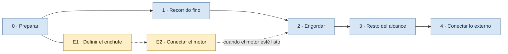

# PLAN MAESTRO — el ciclo de cotización, con el motor de anidado como pieza enchufable

> **Este es el plan vigente.** Ordena todo lo que no es el motor de anidado: en qué etapas se construye, qué queda andando al final de cada una y dónde se conecta el motor cuando esté listo. No detalla tareas: cada sub-proyecto tiene después su propio diseño y su propio plan, en una carpeta de `docs/plan/` (§12).
>
> Índice del proyecto: [`README.md`](../../README.md) · [`MAPA-DEL-PROYECTO.md`](../MAPA-DEL-PROYECTO.md) · [`EPICA.md`](../EPICA.md) · [`BACKLOG.md`](../BACKLOG.md) · [`REGISTRO.md`](../REGISTRO.md) · [`motor/PLAN-RUMBO-ANIDADO-Y-REVISION.md`](../motor/PLAN-RUMBO-ANIDADO-Y-REVISION.md) · [`motor/CONTRATO-NESTING-ENGINE.md`](../motor/CONTRATO-NESTING-ENGINE.md) · [`historico/frontend-cotizador/diseno.md`](../historico/frontend-cotizador/diseno.md)
>
> **Versión:** 1.0 · **Fecha:** 2026-10-05
>
> **Sobre los valores.** Los parámetros, supuestos, insumos y decisiones se citan por ID (`PAR-xx`, `B-xx`, `T-xx`, `D-xx`) y viven en `REGISTRO.md`. Este documento no repite ningún valor. Las decisiones marcadas «nueva» se dieron de alta en el registro en la etapa 0 (§5).

---

## 1. Qué se decidió

Decisiones de Enzo del 2026-10-05, que reemplazan la prioridad del 2026-09-26 («motor antes que cotización», `PLAN-RUMBO-ANIDADO-Y-REVISION.md §1`):

| Tema | Decisión |
|---|---|
| Qué se planifica | Todo lo que no es el motor de anidado. El motor se conecta después |
| Qué usa primero la empresa | El ciclo de cotización completo: armar el presupuesto, generar el PDF, aprobación del dueño y envío al cliente |
| El paso de anidado, mientras no haya motor | Queda vacío. El costo de material figura como pendiente |
| `rectpack` | No es parte del producto. Queda en el código como motor de prueba, deshabilitado en el servidor |
| Quién usa el sistema | La empresa, con sus roles, en un servidor. Hasta la etapa 4 corre en local con Docker, igual que va a correr en el servidor |
| Quién construye | Enzo, un solo carril. Vale sigue con el motor |
| En qué orden | Recorrido fino de punta a punta primero; después se engorda cada paso |
| Lo que depende de afuera | **No frena nada** (Enzo, más tarde el mismo día): servidor, dominio, mail, WhatsApp, logo y formato del presupuesto, y las respuestas del dueño. Cada sub-proyecto usa un reemplazo local y lo real se conecta al final, en la etapa 4 |

**Por qué el recorrido fino.** Con el anidado vacío no puede salir un presupuesto real con chapa hasta que llegue el motor, se construya en el orden que se construya. Ese tiempo rinde más dejando todo el circuito instalado y probado por los roles reales que terminando una sola parte. Lo que depende de afuera no frena ese recorrido: se arma con reemplazos locales y se conecta en la etapa 4.

---

## 2. Punto de partida

El estado de cada parte del sistema al 2026-10-05 está en [`MAPA-DEL-PROYECTO.md §1`](../MAPA-DEL-PROYECTO.md). Lo que importa para este plan:

- El cotizador funciona por API y en pantalla, en local y sin login. Falta el PDF.
- El presupuesto solo conoce el estado borrador: no hay aprobación ni envío.
- El motor está medido, no construido (pasos A1 y A2 de `motor/PLAN-RUMBO-ANIDADO-Y-REVISION.md`). El trabajo de Vale sobre el motor no está en este repositorio a esta fecha; relevarlo es parte de E1 (§4.6).

**Dónde llama hoy el producto a `rectpack`.** En dos lugares, y los dos pasan por el enchufe:

- `_ejecutar_anidado` en `backend/app/api/rutas_nesting.py`, detrás de `POST /grupos/{id}/anidar`.
- `comparar_formatos` en `backend/app/services/nesting/comparador.py`, detrás de `POST /grupos/{id}/comparar-formatos`, que usa la pestaña Grupos.

---

## 3. Forma general

Cinco etapas en fila, porque hay un solo carril, y un carril aparte para el motor.



| Etapa | Qué queda andando al terminar | Sub-proyectos, en orden |
|---|---|---|
| **0. Preparar** | Documentación al día | Registro, mapa y backlog (§5) |
| **1. Recorrido fino** | Un diseñador entra con su usuario, arma un presupuesto con líneas a mano y lo manda a aprobar; el dueño lo aprueba desde un link y al cliente le llega el PDF por mail. Todo en Docker local, con los mails en un buzón de prueba | 1.1 Servidor y login · 1.2 Presupuesto sin anidado · 1.3 PDF mínimo · 1.4 Aprobación mínima · 1.5 Envío por mail |
| **2. Engordar** | El mismo recorrido, con datos y pantallas completos | 2.1 Importar y revisar · 2.2 Catálogo y precios · 2.3 Cotizador completo · 2.4 Aprobación y envío completos · 2.5 Fundaciones completas |
| **3. Resto del alcance** | Lo que no es el ciclo de cotización | 3.1 Dashboard · 3.2 Fotomontaje |
| **4. Conectar lo externo** | El sistema en el servidor real, con mail y WhatsApp reales, el formato de la empresa y las decisiones del dueño confirmadas | 4.1 Servidor y dominio · 4.2 Mail real · 4.3 WhatsApp · 4.4 Formato de la empresa · 4.5 Confirmar con el dueño |

**Carril del motor (Vale):**

- **E1. Definir el enchufe.** Un documento con qué recibe el motor y qué devuelve. Sale primero para que el motor se construya contra eso.
- **E2. Conectarlo.** Cuando el motor esté listo. Es el único paso que junta los dos carriles y puede caer en cualquier etapa.

**Cuatro reglas de orden:**

1. **Importar y revisar abre la etapa 2, antes que precios.** Es lo que le entrega al motor las piezas revisadas y agrupadas por material. Los precios pueden esperar porque el costeo ya funciona con el precio de referencia importado (`D-10`).
2. **En la etapa 1 el recorrido se prueba con presupuestos sin trabajo asociado**, solo con líneas a mano. El modelo lo permite: `Presupuesto.trabajo_id` es opcional.
3. **Cada sub-proyecto tiene su propio ciclo** de diseño, plan y construcción, con el visto bueno de Enzo en cada paso.
4. **Nada de afuera frena una etapa.** Si un sub-proyecto necesita algo de la empresa, trabaja con un reemplazo local (§5) y lo anota en su diseño, para que la etapa 4 sepa qué cambiar. Si necesita una respuesta del dueño, avanza con el valor por defecto del registro y la respuesta se confirma en 4.5.

---

## 4. El enchufe del motor

### 4.1 Dónde está el borde

```
        EL RESTO (Enzo)                MOTOR (Vale)               EL RESTO (Enzo)
importar → revisar → agrupar  →  [ grupo listo → resultado ]  →  guardar → ajustar → plano y DXF → costeo
```

Un **grupo listo** es un grupo de corte con formato asignado, parámetros de corte y al menos una pieza sin descartar. Es lo que ya valida `_datos_para_anidar` antes de encolar.

### 4.2 Qué cruza

| | Qué es | Hoy en el código |
|---|---|---|
| **Entra** | La chapa (ancho y alto del formato), los parámetros de corte (`PAR-01` a `PAR-04`) y las piezas del grupo con contorno, agujeros y cantidad | `_datos_para_anidar` arma chapa y parámetros, pero al motor le pasa solo la caja de cada pieza. Los contornos van aparte, por `_geometrias_del_grupo` |
| **Sale** | Por cada instancia de pieza: en qué chapa quedó, dónde y con qué ángulo. Más la cantidad de chapas y los avisos | `ResultadoAnidado`, en `backend/app/services/nesting/models.py` |
| **Regla** | Ninguna pieza se descarta en silencio. Si no entra, vuelve como aviso o como error | `DECISIONES-Y-BLOQUEANTES.md §1.2` |

**Detalle que E1 tiene que dejar escrito.** El identificador de cada posición viaja como `"<id de pieza>#<instancia>"`, y `_ejecutar_anidado` lo separa al guardar. Un motor que no lo respete falla recién en ese punto.

### 4.3 Qué hace el producto, sea cual sea el motor

Ya lo hace hoy:

- Revisa que el grupo esté listo antes de encolar.
- Corre el anidado en segundo plano, con estados (encolada, corriendo, lista, error, cancelada).
- Calcula él mismo el aprovechamiento con el área real (`ADR-08`). Así dos motores se comparan con la misma vara.
- Guarda las colocaciones y una copia de los parámetros usados.

Pasa a hacerlo en E2:

- Validar el resultado contra la forma real de cada pieza, con la tolerancia `PAR-29`. Hoy esa comprobación vive solo dentro del adaptador de Deepnest (`deepnest_cliente.py`); tiene que valer para cualquier motor.

Aguas abajo nadie conoce al motor: `costeo.py` solo lee la cantidad de chapas de la ejecución marcada como definitiva, y el plano y el DXF de corte leen las colocaciones guardadas.

### 4.4 Cambios en el producto para que el enchufe exista

1. **Una lista de motores con nombre.** `_ejecutar_anidado` y `comparar_formatos` eligen el motor por nombre en vez de instanciar `rectpack` directo.
2. **Motores habilitados por configuración**, igual que ya se elige la base y la cola en `backend/app/config.py`. En el servidor arranca sin ninguno: «Anidar» y «Comparar formatos» responden que no hay motor conectado.
3. **Las piezas viajan con su forma**, no solo con su caja.
4. **Corridas largas sin sorpresas.** Cancelar corta el proceso de verdad, y al reiniciar el servidor las corridas que quedaron a medias se marcan como error. Hoy quedarían «corriendo» para siempre (`backend/app/cola/__init__.py`).

Los cambios 1 y 2 se hacen en la etapa 1, porque son los que dejan a `rectpack` fuera del producto. Los cambios 3 y 4 son parte de E2.

**Qué se ve en pantalla mientras no haya motor.** Las pestañas Anidado y Ajuste no se borran. Anidado muestra «no hay motor conectado», Ajuste no tiene nada que ajustar, Grupos no ofrece comparar formatos y Costeo muestra el material como pendiente, con el aviso que `costeo.py` ya genera.

**`rectpack` como motor de prueba.** Sigue en el código y en los tests, registrado en la lista de motores y habilitado solo en desarrollo. Es lo que permite probar el enchufe sin esperar al motor real.

### 4.5 Qué cae justo en el borde

Los incisos de A3 en `PLAN-RUMBO-ANIDADO-Y-REVISION.md §4` se reparten así:

| Tema | Lado | Por qué |
|---|---|---|
| Regla de las islas: una forma que llena el agujero de otra viaja con ella (A3, inciso 0) | El resto, en 2.1 | Vive en el análisis y decide qué piezas existen. Para las letras está construida desde el 2026-10-08: el análisis marca el recorte y la carga lo deja descartado. Para las piezas que no entran en ninguna chapa, desde el 2026-10-12 ([2.1a](../historico/2.1a-lectura-con-imagen/diseno.md)) |
| Alcance «se re-anida / queda como está» (A3, inciso b) | El resto, en 2.1 | Lo muestra y lo corrige la pantalla de revisión |
| Separar piezas grandes de chicas, colocación directa, chapas con obstáculos e híbrido (A3, incisos a, c, d y e) | El motor | Es estrategia de anidado. El producto no necesita saberlo |

**La regla de las islas es requisito de E2.** Sin ella el motor recibe piezas de más. Si el motor llega antes que 2.1, ese inciso se adelanta solo.

### 4.6 E1 y E2

**E1 — Definir el enchufe.** Entrega: un documento de contrato entre el producto y el motor, aparte de `CONTRATO-NESTING-ENGINE.md`, que describe el contrato entre Python y Node dentro de un motor en particular. Responde `D-14` (nueva): en qué forma llega el motor de Vale. Sin código.

**E2 — Conectar el motor.** Entrega: el motor registrado y habilitado, las piezas viajando con su forma, la validación del resultado hecha por el producto (§4.3), corridas largas resueltas y la pestaña Anidado mostrando el resultado. Cierra `D-12` (espera en segundo plano) y `D-02` (cómo se cobra la chapa). Requisitos: E1, la regla de las islas y un grupo listo.

---

## 5. Etapa 0 — Preparar

Sin código de producto.

**Documentación** (hecha el 2026-10-05):

- Altas en `REGISTRO.md`: `D-14` a `D-18` (§8).
- Corrección de `CART-402` en `BACKLOG.md` y nota sobre `ADR-05` en `EPICA.md` (§9).
- `MAPA-DEL-PROYECTO.md` al día con el estado del §2.
- Entrada en `BITACORA.md`.

**Lo que depende de afuera, y con qué se reemplaza hasta la etapa 4.** Nada de esto frena el trabajo. Se puede pedir antes si conviene, pero ningún sub-proyecto lo espera:

| Qué | Reemplazo local mientras tanto | Se conecta en |
|---|---|---|
| Servidor y dominio (`T-01`, `T-02`) | Docker en local, igual que en el servidor | 4.1 |
| Lugar de los backups (`T-06`) | Backup a una carpeta local | 4.1 |
| Cuenta de mail (`T-03`) | Un buzón de prueba local que muestra los mails sin mandarlos | 4.2 |
| Alta de WhatsApp Business (`B-12`) | Solo mail | 4.3 |
| Logo, datos fiscales y formato del presupuesto (`B-13`) | Una plantilla propia, con el logo como espacio reservado | 4.4 |
| Quién aprueba y por qué canal (`B-11`, `PAR-20`) | Un usuario de prueba con el permiso «puede aprobar», avisado por mail | 4.5 |
| Validez y margen (`PAR-11`, `PAR-12`) | Se cargan a mano en cada presupuesto, como hoy | 4.5 |

**`D-14` tampoco frena:** E1 se escribe con el valor por defecto del registro y Vale lo confirma al leer el contrato.

**Listo cuando:** el registro y el mapa reflejan este plan. **Estado:** hecho el 2026-10-05.

---

## 6. Etapa 1 — Recorrido fino

**Hito.** Con el sistema corriendo en Docker, igual que va a correr en el servidor: un diseñador entra con su usuario, crea un presupuesto con un cliente y líneas cargadas a mano, y lo manda a aprobar. El dueño recibe un mail con un link, abre el presupuesto y lo aprueba. El cliente recibe el PDF por mail. Los mails llegan al buzón de prueba. El presupuesto queda congelado como enviado.

| Sub-proyecto | Lo mínimo para el recorrido | Se posterga a la etapa 2 | Historias que toca | Reemplazo local hasta la etapa 4 |
|---|---|---|---|---|
| **1.1 Servidor y login** | Todo levantado con Docker y PostgreSQL, igual que en el servidor, sin credenciales en el repositorio (`ADR-10`), con backup diario. Usuarios con contraseña y el permiso «puede aprobar». Todas las rutas exigen sesión. Los usuarios se crean por línea de comandos. Lista de motores con ninguno habilitado (§4.4, cambios 1 y 2) | Pantalla de usuarios, menú por rol, auditoría general | `CART-001`, `CART-002` | Docker local en vez del servidor; backup a una carpeta |
| **1.2 Presupuesto sin anidado** | Lista de presupuestos fuera del espacio de trabajo: cliente, líneas a mano por rubro, margen, IVA y total. El material figura «pendiente de anidado» | Insumos elegidos de un catálogo, mano de obra por etapa | `CART-301`, `CART-304` a `CART-308` | Validez y margen a mano |
| **1.3 PDF mínimo** | Una plantilla: logo, cliente, código, fecha, validez, ítems y total. Sin costos internos ni márgenes | Documento interno, plano de corte adentro, fotomontaje | `CART-309` | Plantilla propia, logo como espacio reservado |
| **1.4 Aprobación mínima** | Estados borrador, pendiente, observado y aprobado. Aviso al dueño por mail con link firmado (`PAR-17`). El dueño aprueba u observa sin iniciar sesión. Historial de quién cambió qué estado | Vencimiento automático, anulación, resumen agrupado de avisos | `CART-401` a `CART-404` | Usuario de prueba que aprueba; buzón de prueba |
| **1.5 Envío por mail** | Al aprobar sale el PDF al cliente y el presupuesto queda como enviado, con el PDF y las líneas congelados. Se puede aprobar sin enviar. El cliente tiene un email cargado | WhatsApp, reintentos, respuesta del cliente por link | `CART-405`, `CART-406`, `CART-004` | Buzón de prueba |

**1.3 quedó construido el 2026-10-12, está en `main` desde el 2026-10-13** ([PR #19](https://github.com/enzopazzelli/carteleria/pull/19)) **y se cerró el 2026-10-14:** [`historico/1.3-pdf-del-presupuesto/`](../historico/1.3-pdf-del-presupuesto/). El 2026-10-13, antes de fusionar, el PDF pasó de WeasyPrint a ReportLab (`D-16`). Tomó de 1.2 la edición del presupuesto: el texto y el precio de cada ítem para el cliente, el total fijado, editar y borrar líneas, y cambiar la validez y el cliente, todo desde la pestaña Costeo. De 1.2 queda la lista de presupuestos fuera del trabajo.

**Pendientes del PDF del presupuesto (1.3).** Lo que quedó vivo y se sigue desde acá. El detalle está en los «Desvíos» de su [`plan.md`](../historico/1.3-pdf-del-presupuesto/plan.md).

| Pendiente | De dónde sale | Depende de |
|---|---|---|
| Una pantalla para retocar el presupuesto: a un lado los campos, al otro el PDF de verdad, que se vuelve a dibujar con cada cambio. Editar los textos, agregar textos libres (condiciones, forma de pago, plazo) y elegir qué se muestra | Pedido de Enzo del 2026-10-13 | — |
| El recorrido de Enzo en un navegador con ventana, sobre todo que el archivo se descargue: Chrome sin ventana no guarda descargas | Cierre del PR #19 | — |
| Un descuento como renglón con precio negativo: hoy la pantalla no lo acepta, y un total fijado con suma negativa invierte los signos en lugar de contar como incompleto | Revisión de la rama | `P-33` |
| Juntar varias líneas de costo en un solo ítem, y registrar quién cambió un precio | §3 de su diseño | `P-34` |
| Los botones «a mano · quitar» y «fijado · quitar» pueden perder un clic, como le pasaba al de descargar | Revisión de la rama | — |
| Sin total fijado, «Precio base» y «En el presupuesto» pueden diferir en centavos, y todos los centavos del redondeo van a un solo ítem | Revisión de la rama | — |
| La prueba de muchos renglones no comprueba que el bloque de totales quede entero, y dos líneas sin costo con la misma descripción repiten la clave de la lista de lo que falta | Revisión de la rama | — |

**Regla para mandar a aprobar.** El presupuesto tiene cliente, al menos una línea de costo y ningún material pendiente. **Material pendiente** es una línea de rubro material sin valor efectivo: ni calculado ni cargado por override. Si falta algo, el sistema lo rechaza diciendo qué falta.

**Punto abierto de 1.2 (`D-18`, nueva).** El override manual de `ADR-07` ya existe y hoy alcanza a cualquier línea, también a una de material sin anidado. Eso permitiría completar a mano el costo de la chapa y emitir el presupuesto antes de que llegue el motor. Si se permite o se bloquea en ese caso se decide en el diseño de 1.2.

**Qué congela 1.5.** El PDF y las líneas de costo. Todavía no la versión de cada precio, porque los precios con vigencia llegan en 2.2. Alcanza para esta etapa, donde las líneas se cargan a mano.

---

## 7. Etapas 2, 3 y 4 — alcance y orden

Se detallan cuando les toque, cada una con su diseño.

| Sub-proyecto | Alcance | Historias | Depende de |
|---|---|---|---|
| **2.1 Importar y revisar** | El carril B de `PLAN-RUMBO-ANIDADO-Y-REVISION.md §5` (pasos B1 a B6): pantalla de importación, visor con roles y confirmación. Más la regla de las islas, el alcance de cada diseño y la asignación de material. Se partió en dos el 2026-10-12: **2.1a**, leer mejor y mostrar el dibujo antes de cargar, construida y en `main` desde el 2026-10-12: [`historico/2.1a-lectura-con-imagen/`](../historico/2.1a-lectura-con-imagen/diseno.md); y **2.1b**, corregir la lectura a mano con clics sobre el dibujo, construida y en `main` desde el 2026-10-13: [`historico/2.1b-corregir-la-lectura/`](../historico/2.1b-corregir-la-lectura/diseno.md) | `CART-506`, `CART-507` | `D-13` |
| **2.2 Catálogo y precios** | Precios con vigencia, carga desde la planilla de la empresa, insumos que no son chapa, historial. Completa lo que falta de materiales y parámetros de corte | `CART-101`, `CART-103` a `CART-107` | `D-10` |
| **2.3 Cotizador completo** | Insumos desde catálogo, mano de obra por etapa, documento interno, PDF completo | `CART-304`, `CART-305`, `CART-309`, `CART-310` | 2.2 |
| **2.4 Aprobación y envío completos** | Reintentos, respuesta del cliente, vencimientos, congelado con versiones de precio | `CART-401`, `CART-405`, `CART-407`, `CART-408` | 2.2, `D-07`, `D-17` |
| **2.5 Fundaciones completas** | Pantallas de usuarios y clientes, menú por rol, auditoría general | `CART-003` a `CART-006` | — |
| **3.1 Dashboard** | Las vistas relevadas en `DASHBOARD-VISTAS.md` | `CART-801` a `CART-808` | `D-09` |
| **3.2 Fotomontaje** | Composición del cartel sobre la foto del local (`ADR-03`) | `CART-601` a `CART-607` | 2.3 |
| **4.1 Servidor y dominio** | Llevar al servidor real lo que ya corre en Docker, con HTTPS y los backups donde se defina | `CART-001` | `T-01`, `T-02`, `T-06` |
| **4.2 Mail real** | Cambiar el buzón de prueba por la cuenta real | `CART-403`, `CART-406` | `T-03` |
| **4.3 WhatsApp** | Aviso al dueño y envío al cliente por WhatsApp | `CART-403`, `CART-406` | `B-12`, `D-04` |
| **4.4 Formato de la empresa** | Logo, datos fiscales y formato del presupuesto en el PDF | `CART-309` | `B-13` |
| **4.5 Confirmar con el dueño** | Lo que avanzó con su valor por defecto: quién aprueba, validez, margen, `D-07`, `D-15`, `D-17`, `D-20` y `D-21` | — | `B-11`, `PAR-11`, `PAR-12`, `PAR-20` |

**Lo que no entra en ninguna etapa de este plan**, y por qué:

| Historias | Motivo |
|---|---|
| `CART-701` a `CART-705` | Son el motor. Carril de Vale. El seccionado (A5) lo tomó Enzo el 2026-10-07, y está construido y en `main` desde el 2026-10-09: `historico/A5-seccionado/`. Sus pendientes están al pie de esta tabla. El reparto por chapa (A6), que usa el tiempo que sobra del anidado con Sparrow para vaciar las chapas a medio llenar, lo construyó Enzo sin esperar la respuesta de Vale, y está en `main` desde el 2026-10-10: `historico/A6-reparto-por-chapa/`. Sus pendientes también están al pie de esta tabla |
| `CART-205`, `CART-207`, `CART-208`, `CART-210` | Dependen de que haya un resultado de anidado. Se retoman después de E2 |
| `CART-201` | La carga manual de piezas existe como servicio, sin ruta propia. Si hace falta se decide en el diseño de 2.1 |
| `CART-501`, `CART-502`, `CART-504` | Dependen de acordar una convención de capas con diseño (`SUP-05`, `B-15`, `D-11`) |
| `CART-209`, `CART-508` | Plegado. Dependen de `D-03` |

**Pendientes del seccionado.** El seccionado se cerró el 2026-10-09 y su carpeta pasó a [`historico/A5-seccionado/`](../historico/A5-seccionado/). Esto es lo que quedó vivo y se sigue desde acá. El detalle de cada punto está al final de su [`plan.md`](../historico/A5-seccionado/plan.md).

| Pendiente | De dónde sale | Depende de |
|---|---|---|
| Validar con el aro real exportado soldado | §7 de su diseño | `SUP-17`: que el diseñador lo mande |
| La segunda pasada de la búsqueda repite ángulos ya probados: solo afina el corrimiento | Revisión | — |
| No hay tope para chapas chicas pero válidas, y el selector de chapa del panel lista todo el catálogo | Revisión | La tabla de A8 (`ListaDeFormatos`, con filtros y buscador; [`historico/A8-lista-de-materiales-y-retazos/`](../historico/A8-lista-de-materiales-y-retazos/diseno.md)) sirve para el selector |
| Una pieza tiene un solo seccionado, para una chapa: la comparación de formatos usa los tramos aunque la pieza entraría entera en una chapa más grande | Revisión | — |
| Con veta, los tramos quedan girados respecto del dibujo | Revisión | `P-30` |
| La comparación de formatos usa los parámetros de corte del material aunque el grupo tenga propios | Arreglo del 2026-10-09 | `CART-210` |
| La fila de la pieza seccionada queda atenuada y sus enlaces parecen deshabilitados | Panel | — |
| Dos colores no alcanzan para distinguir tramos vecinos | Panel | — |
| Arrastrar la grilla deja medidas no redondas: falta decidir si se ajusta a milímetros enteros | Panel | Decisión de Enzo |
| El botón «Seccionar» se decide con una cuenta sin márgenes ni kerf: una pieza casi del tamaño de la chapa no lo muestra | Panel | `P-28` |
| La pieza 1009 del trabajo 4 parece un plano de referencia y no una pieza a cortar | Panel | 2.1, la revisión de la importación |

**Resueltos el 2026-10-14** (rama `fix/depuracion`): «Volver a seccionar» abre con el corte guardado; un ángulo o un corrimiento infinito o que no es un número da un aviso y no un 500, y una pieza descartada a mano no se secciona; no se secciona ni se deshace mientras corre un anidado del grupo, ni se vuelve a cargar el dibujo mientras corre uno del trabajo.

**Pendientes del reparto por chapa.** El reparto por chapa se cerró el 2026-10-10 y su carpeta pasó a [`historico/A6-reparto-por-chapa/`](../historico/A6-reparto-por-chapa/). Esto es lo que quedó vivo y se sigue desde acá. El detalle de cada punto está al final de su [`plan.md`](../historico/A6-reparto-por-chapa/plan.md), en «Desvíos».

| Pendiente | De dónde sale | Depende de |
|---|---|---|
| Decidir cómo repartir el tiempo entre las pasadas y la etapa de vaciar chapas: con la casilla marcada suele correr una sola pasada, y si sale mala el resultado puede tener más chapas que con la casilla apagada | Revisión del 2026-10-10; §8 de su diseño | Medir un trabajo grande; hablarlo con Vale |
| Medir un trabajo con muchas más piezas | Tarea 6 de su plan | Un trabajo con grupos armados: `Muestra Vectores` no los tiene en el respaldo |
| Las preguntas a Vale: si tiene cambios en curso sobre `sparrow_worker.py` y si ya había probado otro reparto | Tarea 0 de su plan | Vale |
| El aviso «Se alcanzó el límite de búsqueda» sale en buena parte de las corridas con la etapa prendida: el worker estima corto lo que dura una consulta | Revisión | — |
| Ningún test corre la etapa por el camino del worker aparte y su archivo de salida | Revisión | — |
| El texto de ayuda de Anidado dice «Más búsqueda por chapa no da menos planchas» como si fuera una regla | Revisión | Decisión de Enzo |
| `GUIA-SPARROW-PRUEBAS.md` sugiere 120 s como punto de partida y `motor/PLAN-VALIDACION-CORTE-MANUAL.md` nombra `PAR-09` con su valor anterior | Tarea 5 bis de su plan | — |
| Medir «Girar a cualquier ángulo» con «Complejo», con la casilla marcada y sin marcar: si con el mismo tiempo da mejor o peor | Rama `feat/giro-libre`, 2026-10-14 | La prueba de Enzo |
| Con giro libre, si una pieza entra en la chapa se sigue decidiendo con cuartos de vuelta: una que solo entra en diagonal se manda a seccionar | Rama `feat/giro-libre`, 2026-10-14 | Que aparezca un caso |
| Otras rutas cambian piezas aunque corra un anidado: editar una pieza (grupo, cantidad, descartar), borrar un grupo y borrar un trabajo. Volver a cargar el dibujo y seccionar ya lo rechazan | Revisión de `fix/depuracion`, 2026-10-14 | — |
| La carpeta temporal de cada corrida de Sparrow sale de la carpeta temporal del sistema, en C:, que en la máquina de Enzo está casi llena. Iría mejor al lado de los datos (`CARTELERIA_DATOS`) | Revisión de `fix/depuracion`, 2026-10-14 | — |

**Resueltos el 2026-10-14** (rama `fix/depuracion`): si falla la etapa de vaciar chapas, el motivo llega a los avisos del resultado; si falla una pasada posterior o el worker termina con error, vale el último anidado que dejó escrito; el worker da por mejor un resultado recién cuando quedó escrito; y el filtro por área ya no saltea, por redondeo, piezas que llenan la chapa justa. **Y en la rama `feat/giro-libre`:** Sparrow gira las piezas a cualquier ángulo, con la casilla «Girar a cualquier ángulo» en Anidado y en la comparación de chapas, marcada por defecto (Enzo) y sin efecto con veta. **Y la barra de progreso (A7), en `main` desde el 2026-10-14 ([`historico/A7-progreso-del-anidado/`](../historico/A7-progreso-del-anidado/diseno.md)):** barra de progreso al anidar y al comparar chapas, y la comparación en segundo plano, con cancelar y retomar; con eso deja de ser un solo pedido largo que el navegador podía cortar.

**Pendientes de los mensajes entendibles (A9).** Construido el 2026-10-22, en `main` desde ese día ([PR #26](https://github.com/enzopazzelli/carteleria/pull/26)) y cerrado: [`historico/A9-mensajes-entendibles/`](../historico/A9-mensajes-entendibles/diseno.md). Resolvió dos pendientes de otras tablas: una chapa de la comparación que no llega a tiempo **falla sola en su fila** y las demás se muestran (antes la comparación entera terminaba en error), y **«Margen %» e «IVA %» aceptan coma** («10,5»). Lo que quedó vivo:

| Pendiente | De dónde sale | Depende de |
|---|---|---|
| Con el servidor apagado al abrir una pestaña, la pantalla queda en blanco: solo avisan las acciones (anidar, guardar), no las consultas que cargan la pestaña | Recorrido de A9 | — |
| Un mensaje que nombra muchas piezas escribe todos los nombres: con 32 piezas el texto se hace largo. Mostrar los primeros y «y N más», con las miniaturas al lado | Recorrido de A9 | — |
| En la comparación, dos chapas de la misma medida y distinto espesor se ven iguales: la fila no dice el espesor | Recorrido de A9; es anterior | — |
| La miniatura de una chapa en Ajuste puede mostrar el plano de antes del movimiento: la dirección es la misma y el navegador la guarda | Recorrido de A9 | — |
| El error y los avisos de un anidado del historial no se ven al volver a la pestaña: solo los del que está en curso, aunque el error queda guardado entero | Revisión de A9 | — |
| Que el aviso de un error en la comparación distinga «el servidor se reinició» de «la reemplazó una comparación más nueva» | Revisión de A9 | — |
| El mensaje del motor rectangular cuando no ubica piezas no dice qué hacer ni la medida de la chapa | Revisión de A9; texto del diseño | — |
| En Ajuste, varias piezas en rojo por el margen dan varios avisos iguales: no nombran la pieza | Revisión de A9 | — |
| Las trazas de un error inesperado ya no salen por la consola del servidor, solo en el registro; y la línea de lo que escribió el cálculo no dice de qué anidado es | Revisión de A9 | — |
| Los mensajes de la importación de varios diseños (`/importaciones/dxf/...`) solo se revisaron con la regla, sin miniaturas; la comparación con el motor rectangular de prueba sigue cayéndose entera si falla un formato | §4 de su diseño | Que una pantalla los use |

**Pendientes de la lectura con imagen (2.1a).** Se cerró el 2026-10-12 y su carpeta pasó a [`historico/2.1a-lectura-con-imagen/`](../historico/2.1a-lectura-con-imagen/). Esto es lo que quedó vivo y se sigue desde acá. El detalle está en los «Desvíos» de su [`plan.md`](../historico/2.1a-lectura-con-imagen/plan.md).

| Pendiente | De dónde sale | Depende de |
|---|---|---|
| Repetir con varias corridas la comparación con y sin «vaciar chapas» sobre el trabajo bien leído. Una sola corrida de Enzo, con el aro unido y seccionado, dio 8 chapas (las mismas que el armado a mano del diseñador); lo medido el 2026-10-10 incluía 18 m² de huecos | §2 de su diseño; bitácora del 2026-10-12 | — |
| La importación de varios diseños (`/importaciones/dxf/...`) no une | §3 de su diseño | Carril B, B2 y B4. 2.1b también dejó afuera los archivos con varios diseños |
| Una franja chica enganchada en otra se lee al revés, y una letra cuyo hueco se acerca a menos de `PAR-50` de su borde queda maciza al unir | Revisión de la rama | — (2.1b no tocó la regla de unir) |
| Los huecos de una pieza unida suman filas descartadas a la tabla de Piezas (25 en el aro) | §7 de su diseño | Decisión de Enzo |
| Si la excepción del rectángulo vale también para la forma de adentro: hoy una pieza irregular que no entra en ninguna chapa no descarta un hueco rectangular que tampoco entra | Revisión de la rama | Decisión de Enzo |
| El lector toma como pieza un agujero que está adentro de dos formas a la vez: sin unir, un tornillo en el borde del aro sale como pieza a cortar | Revisión de la rama; es anterior a este sub-proyecto | — |
| `dibujo.ts` calcula la caja con `Math.min(...)`, que con un archivo mucho más grande que la muestra puede fallar; y la lectura manda los números con todos sus decimales (2,3 MB en la muestra) | Revisión de la rama | — |

**Resueltos el 2026-10-14** (rama `fix/depuracion`): una carga sin nada para cortar no borra las piezas (el panel ya no lo permitía desde 2.1b; ahora tampoco la API), y un archivo que no se puede leer no pisa el DXF guardado; el aviso de las formas sin unir dice dónde está la casilla; `pytest` solo junta `tests/`; y las miniaturas ya no salen dadas vuelta.

**Pendientes de corregir la lectura a mano (2.1b).** Se cerró el 2026-10-13 y su carpeta pasó a [`historico/2.1b-corregir-la-lectura/`](../historico/2.1b-corregir-la-lectura/). Esto es lo que quedó vivo y se sigue desde acá. Lo menor que señaló la revisión de la rama está en los «Desvíos» de su [`plan.md`](../historico/2.1b-corregir-la-lectura/plan.md).

| Pendiente | De dónde sale | Depende de |
|---|---|---|
| El lector decide pieza o agujero por cuántos contornos encierran a la forma: el mismo dibujo se lee distinto solo que junto a otros | §2 y §7 de su diseño | — |
| Elegir qué grupo de formas se une: la casilla vale para el archivo entero | §3 de su diseño | Que aparezca un diseño que lo pida |
| Marcar de a muchas formas con un recuadro. Al sacar una placa con tornillos hay que sacar cada tornillo | §3 y §7 de su diseño | Que haga falta |
| Recordar las correcciones de una carga a la otra | §3 de su diseño | — |
| Corregir la lectura en la importación de varios diseños (`/importaciones/dxf/...`) | §3 de su diseño | Carril B, B2 y B4 |

---

## 8. Decisiones abiertas

Cada una avanza con su valor por defecto hasta que se cierre. El enunciado completo y el valor por defecto de cada una están en [`REGISTRO.md §5`](../REGISTRO.md); acá solo va en qué paso se cierra. Las que dependen de una respuesta de la empresa (`D-07`, `D-15`, `D-17`) se construyen con su valor por defecto en ese paso y se confirman en 4.5.

| ID | Decisión, en corto | Se cierra en |
|---|---|---|
| `D-13` | Qué hace el sistema con un diseño que «queda como está» | 2.1 |
| `D-14` | En qué forma llega el motor de Vale | E1 |
| `D-15` | Aprobación del presupuesto entero o ítem por ítem | 1.4 |
| `D-17` | Al aceptar el cliente, ¿se crea sola la nota de pedido en AppSheet? | 2.4 |
| `D-18` | ¿El override puede completar una línea de material sin anidado? | 1.2 |
| `D-20` | Qué fecha lleva el presupuesto y desde cuándo corre la validez | 4.5 |
| `D-21` | El total fijado a mano, con IVA o sin IVA | 4.5 |
| `D-08` | Retención y backup de archivos generados | 1.1 |
| `D-10` | Fórmula del costo por unidad de venta | 2.2 |
| `D-04` | WhatsApp directo o por un intermediario | 4.3 |
| `D-07` | Presupuesto vencido: se reajusta o solo se marca | 2.4 |
| `D-02` | Se cobra la chapa entera o lo que se usa | E2 |
| `D-12` | El anidado corre con alguien esperando o en segundo plano | E2 |
| `D-01` | Qué motor para piezas irregulares (enunciado desactualizado) | E2 |
| `D-09` | Dashboard de solo lectura o con escrituras | Antes de 3.1 |
| `D-06` | Modelo de agregados del dashboard | 3.1 |
| `D-05` | Proveedor de IA para el retoque del fotomontaje | 3.2 |

**`D-13` cambió de peso.** Con el anidado vacío hasta el motor, los diseños que el motor no toca no tendrían costo de material nunca, ni siquiera con el motor conectado. Son la mayoría de la muestra medida en `PLAN-RUMBO-ANIDADO-Y-REVISION.md §2.4`. Hay que cerrarla en 2.1.

---

## 9. Correcciones a documentos existentes

Se aplican en la etapa 0.

- **`CART-402` exige «al menos una pieza» para mandar a aprobar.** Choca con el modelo, que admite presupuestos sin chapa, y con la regla 2 del §3. Pasa a regir la regla del §6.
- **`ADR-05` nombra Next.js, Celery y Redis.** Lo construido es Vite con React y una cola de hilos, y este plan sigue con eso. Celery entra solo si las corridas largas del motor lo piden (E2). Next.js se reconsidera al diseñar el dashboard (3.1), que era su justificación.
- **`ADR-01` y `EPICA.md §8` ponen el anidado rectangular como base del primer hito.** Con `rectpack` fuera del producto, el primer hito de este plan es el recorrido fino del §6, sin anidado.
- **`PLAN-RUMBO-ANIDADO-Y-REVISION.md §1`** dice que el carril A es el camino crítico. Deja de serlo para Enzo: el carril A pasa a ser el de Vale y el carril B pasa a ser 2.1.

---

## 10. Riesgos

| Riesgo | Efecto | Qué se hace |
|---|---|---|
| Lo real se conecta al final (etapa 4) | Las sorpresas de servidor, mail o formato aparecen tarde | Docker igual al servidor desde 1.1, y cada reemplazo local anotado en el diseño de su sub-proyecto, para saber qué cambiar |
| WeasyPrint es incómodo de instalar en Windows, donde se desarrolla | 1.3 se traba en el entorno | Pasó: pedía MSYS2 con Pango. El 2026-10-13 se cambió a ReportLab, que se instala con `pip` y nada más (`D-16`) |
| El alta de WhatsApp Business tarda semanas | 4.3 se atrasa | Se puede pedir antes sin frenar nada. El mail cubre todo el recorrido |
| No se sabe en qué forma llega el motor | E2 puede necesitar un adaptador que nadie planificó | E1 lo pregunta primero (`D-14`) |
| Sin motor no se emite ningún presupuesto con chapa | La empresa prueba el circuito pero no lo usa para trabajos reales | Es consecuencia aceptada del §1. `D-18` es la única vía que lo cambiaría |
| Cada paso se construye dos veces, fino y completo | Retrabajo en pantallas | Las migraciones de Alembic están desde el primer commit, así que el modelo crece sin rehacerse |
| El motor llega antes que 2.1 | E2 no tiene piezas revisadas ni regla de las islas | Se adelanta ese inciso (§4.5) |

---

## 11. Cómo se verifica

- **Etapa 0:** revisión de Enzo sobre el registro y el mapa.
- **E1:** el documento de contrato, leído y aceptado por Vale.
- **Etapa 1:** el hito del §6, hecho en Docker local con tres usuarios de prueba (diseñador, dueño y cliente) y los mails en el buzón de prueba. Cada sub-proyecto con tests automatizados para su lógica; la máquina de estados es obligatoria según `EPICA.md §14`.
- **E2:** un grupo listo se anida con el motor real, el resultado pasa la validación contra la forma real y la línea de material del presupuesto se llena sola.
- **Etapas 2 y 3:** se define en el diseño de cada sub-proyecto.
- **Etapa 4:** el hito del §6 otra vez, en el servidor real y con personas reales.

---

## 12. Qué sigue y dónde se escribe

1. **E1**, el primer sub-proyecto con su propio diseño, porque es corto y es lo único que el carril del motor espera de este lado. Se escribe con el valor por defecto de `D-14`.
2. Después **1.1**.

**Cada sub-proyecto vive en su propia carpeta** dentro de `docs/plan/`, con el número de este documento: `docs/plan/E1-enchufe-del-motor/`, `docs/plan/1.1-servidor-y-login/`, etc. Adentro van `diseno.md` y, cuando se escriba, `plan.md`. Al terminar un sub-proyecto, su carpeta pasa a `docs/historico/`. La regla completa está en [`CONVENCIONES.md §8 bis`](../CONVENCIONES.md).
